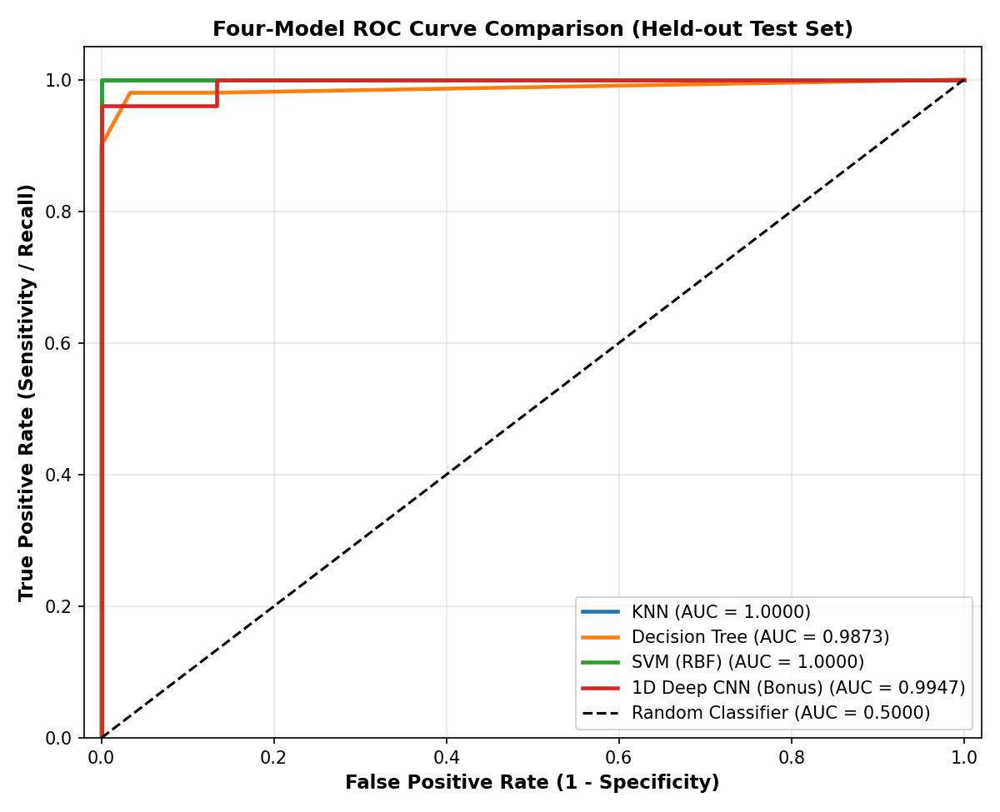
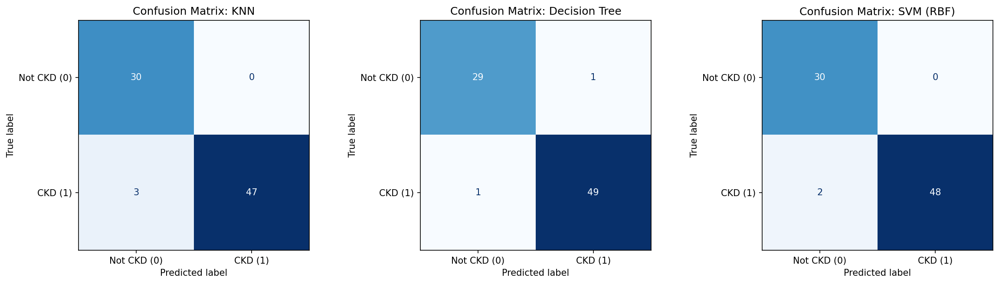
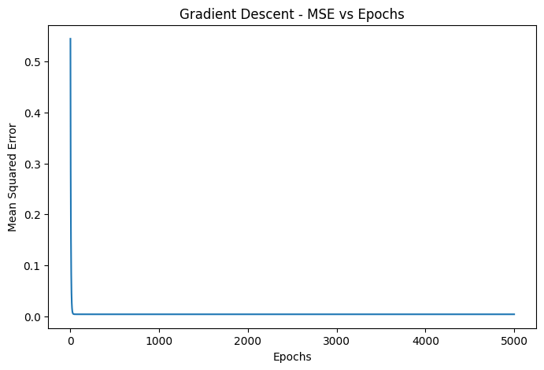
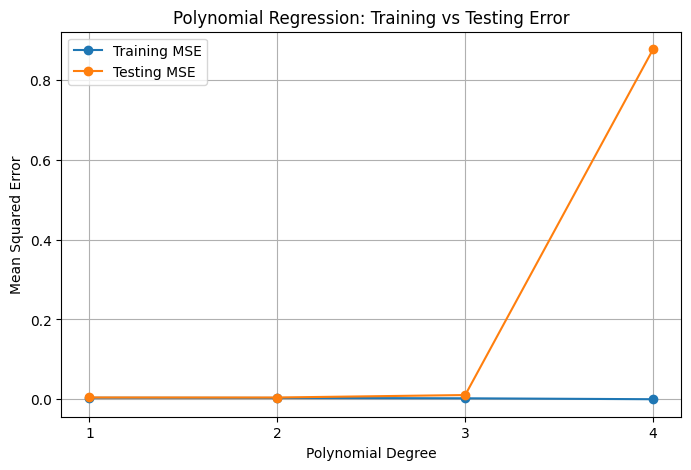
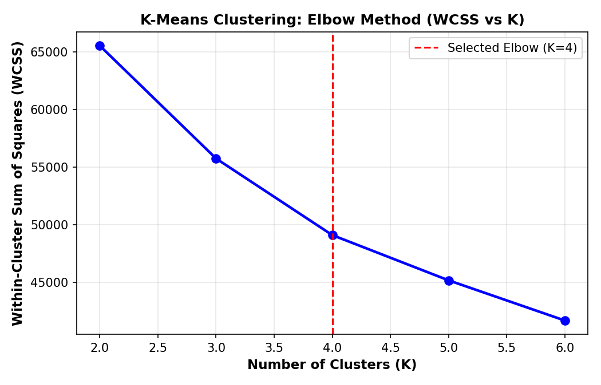
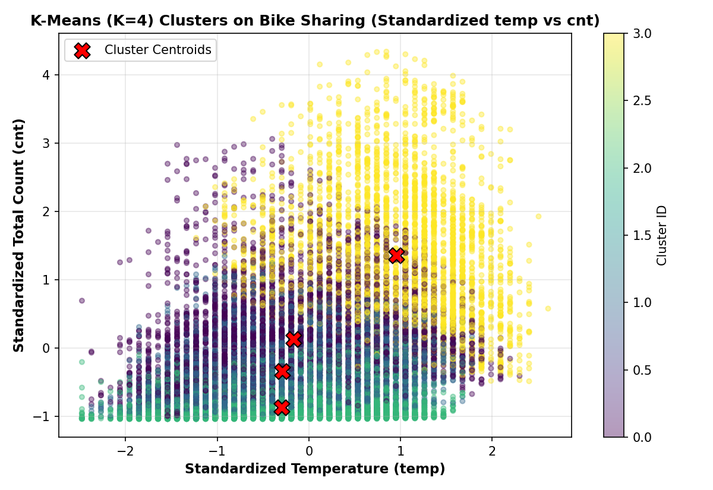
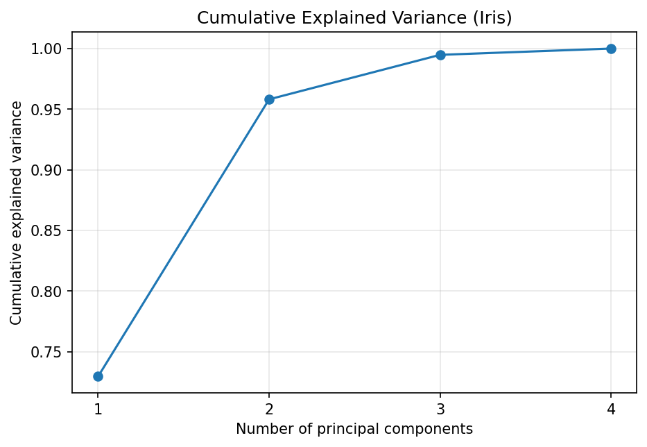
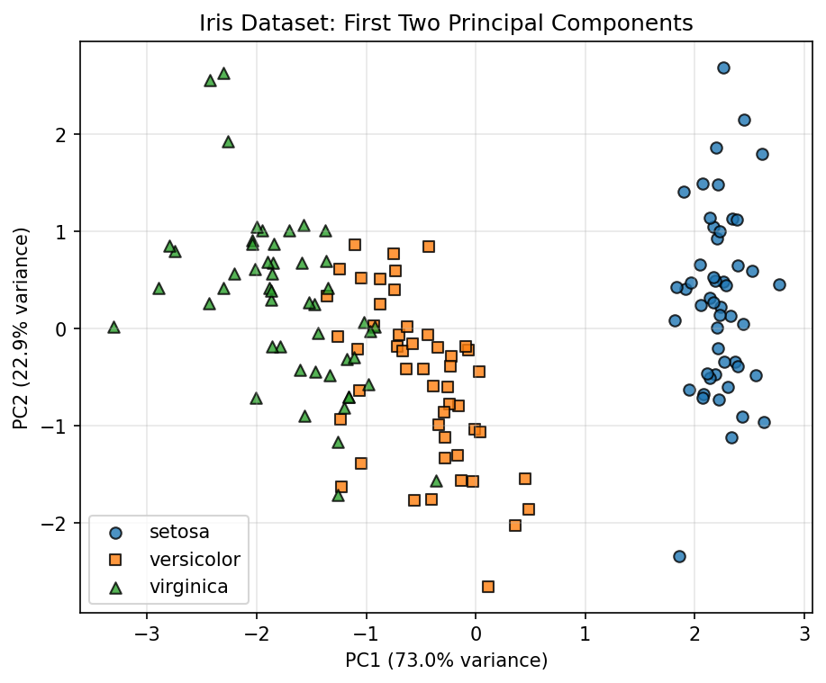

# ML Algorithm Lab

**Supervised and unsupervised machine learning: classification, regression, K-Means clustering and PCA.**

Machine Learning course project, Indian Institute of Information Technology Sri City (Section 2, November 2026).

[](https://apuri-rushi.github.io/ml-algorithm-lab/)


-FF6F00?logo=tensorflow&logoColor=white)


🌐 **Results website:** https://apuri-rushi.github.io/ml-algorithm-lab/
It covers each question with its models, results tables, graphs and short theory.

---

## Contents

- [Results at a glance](#results-at-a-glance)
- [Datasets](#datasets)
- [Question 1: Classification](#question-1-classification)
- [Question 2: Regression](#question-2-regression)
- [Question 3: K-Means clustering](#question-3-k-means-clustering)
- [Question 4: Principal Component Analysis](#question-4-principal-component-analysis)
- [Repository structure](#repository-structure)
- [Getting started](#getting-started)
- [Results website](#results-website)
- [Limitations](#limitations)
- [Contributors](#contributors)

---

## Results at a glance

| Question | Task | Dataset | Best model | Key result |
|---|---|---|---|---|
| Q1 | Classification | Chronic Kidney Disease | **SVM (RBF)** | Test ROC-AUC **1.000**, accuracy **97.5 %** |
| Q2 | Regression | Graduate Admissions | **Polynomial, degree 2** | Test R² **0.825**, RMSE **0.067** |
| Q3 | Clustering | Bike Sharing (hourly) | **K-Means, K = 4** (from scratch) | WCSS **49,113.85**, chosen by the elbow method |
| Q4 | Dimensionality reduction | Iris | **PCA, 2 components** (from scratch) | **95.81 %** of variance retained |

All supervised models use an 80 : 20 train–test split with `random_state = 42`.
Preprocessing is fitted on the training data only. Hyper-parameters are chosen by 5-fold cross-validation, never by test scores.

---

## Datasets

| Dataset | Source | Size | Used for |
|---|---|---|---|
| Chronic Kidney Disease | [UCI](https://archive.ics.uci.edu/dataset/336/chronic+kidney+disease) | 400 patients, 24 attributes | Q1 |
| Graduate Admissions | [Kaggle](https://www.kaggle.com/datasets/mohansacharya/graduate-admissions) | 400 applicants, 7 features | Q2 |
| Bike Sharing (hourly) | [UCI](https://archive.ics.uci.edu/dataset/275/bike+sharing+dataset) | 17,379 hours | Q3 |
| Iris | [UCI](https://archive.ics.uci.edu/dataset/53/iris) (bundled with scikit-learn) | 150 flowers, 4 measurements | Q4 |

The raw data files are not committed (see [datasets/README.md](datasets/README.md)). Download them into the following paths:

```
datasets/raw/chronic_kidney_disease/chronic_kidney_disease.arff
datasets/raw/graduate_admissions/Admission_Predict.csv
datasets/raw/bike_sharing/hour.csv
```

---

## Question 1: Classification

**Goal:** predict whether a patient has chronic kidney disease (CKD).

- **Preprocessing:**
  - Numerical columns: median imputation, then standardisation.
  - Categorical columns: most-frequent imputation, then one-hot encoding.
  - Everything runs inside a scikit-learn `Pipeline`, so nothing leaks from the test set.
- **Tuning:** `GridSearchCV`, 5-fold stratified cross-validation, scored on ROC-AUC.

| Model | Best hyper-parameters | Accuracy | Precision | Recall | F1 | ROC-AUC |
|---|---|---|---|---|---|---|
| KNN | K = 9, Manhattan | 0.9625 | 1.000 | 0.94 | 0.9691 | 1.0000 |
| Decision Tree | depth 3, min leaf 5 | 0.9750 | 0.980 | **0.98** | **0.9800** | 0.9873 |
| **SVM (RBF)** | C = 0.1, γ = scale | **0.9750** | 1.000 | 0.96 | 0.9796 | **1.0000** |
| 1D CNN (bonus) | 2 × Conv1D, early stopping | 0.9750 | 1.000 | 0.96 | 0.9796 | 0.9947 |

KNN and SVM tie on ROC-AUC. SVM is selected because it has the higher accuracy and F1 and no false positives.

<p align="center"> </p>

---

## Question 2: Regression

**Goal:** predict an applicant's *Chance of Admit*.

**Models:**
- Linear regression trained with **gradient descent written from scratch**.
- Polynomial regression of degree 1–4.
- Ridge and Lasso, with α chosen by 5-fold CV.

| Model | Train MSE | Test MSE | Test RMSE | Test R² |
|---|---|---|---|---|
| Linear (gradient descent) | 0.00387 | 0.00462 | 0.0680 | 0.8212 |
| **Polynomial, degree 2** | 0.00346 | **0.00451** | **0.0672** | **0.8254** |
| Polynomial, degree 3 | 0.00253 | 0.01069 | 0.1034 | 0.5862 |
| Polynomial, degree 4 | 0.00021 | 0.87718 | 0.9366 | −32.97 |
| Ridge (α = 23.36) | 0.00391 | 0.00480 | 0.0693 | 0.8140 |
| Lasso (α = 0.000886) | 0.00387 | 0.00466 | 0.0683 | 0.8194 |

**Findings:**
- **Overfitting:** degree 4 fits the training data almost perfectly but fails on unseen data.
- **Strongest predictor:** CGPA.

<p align="center"> </p>

---

## Question 3: K-Means clustering

**Goal:** group similar hours of bike-sharing weather and time conditions.

- **Features:** `hour_sin`, `hour_cos` (cyclic hour), `temp`, `hum`, `windspeed`, all standardised.
- **Implementation:** K-Means written in **NumPy from scratch** (assign → update → repeat), with 10 random restarts.
- **Choosing K:** the elbow method on WCSS for K = 2 … 6 gives **K = 4**.

| K | 2 | 3 | **4** | 5 | 6 |
|---|---|---|---|---|---|
| WCSS | 65,562 | 55,764 | **49,114** | 45,186 | 41,696 |

**The four clusters:**
- Warm and dry
- Cool and windy
- Humid and mild
- Humid and calm

Warm, dry hours average about **3 ×** the rentals of humid hours, even though rentals were never used as an input.

<p align="center"> </p>

---

## Question 4: Principal Component Analysis

**Goal:** reduce the 4 Iris measurements to fewer dimensions.

**Method (NumPy only, no PCA estimator):**
1. Standardise the features.
2. Compute the covariance matrix.
3. Eigen-decompose it with `np.linalg.eigh`.
4. Sort the components by eigenvalue.
5. Project the data onto the top components.

| Component | Eigenvalue | Variance explained | Cumulative |
|---|---|---|---|
| PC1 | 2.938 | 72.96 % | 72.96 % |
| PC2 | 0.920 | 22.85 % | **95.81 %** |
| PC3 | 0.148 | 3.67 % | 99.48 % |
| PC4 | 0.021 | 0.52 % | 100.00 % |

**What the components mean:**
- **PC1** represents overall flower size.
- **PC2** is dominated by sepal width.
- In 2-D, setosa separates cleanly from the other two species.

<p align="center"> </p>

---

## Repository structure

```
ml-algorithm-lab/
├── classification/
│   ├── classification/        # KNN, Decision Tree, SVM script + results (CSV, plots)
│   └── 04_deep_cnn/           # 1D CNN bonus notebooks
├── regression/                # Notebooks 00–06: exploration → GD → polynomial → Ridge/Lasso → comparison
├── unsupervised/
│   ├── K-means/               # Exploration, preprocessing, K-Means from scratch
│   └── PCA/                   # PCA from scratch + eigenvalues, eigenvectors, projections
├── demo/                      # One-command scripts that reproduce every result
├── website/                   # React results website + local Python model server
├── imgs/, imgs_for_Kmeans&Regression/   # Figures used in the report
├── datasets/                  # Dataset sources (raw files are downloaded locally)
└── requirements.txt
```

---

## Getting started

```bash
git clone https://github.com/Apuri-Rushi/ml-algorithm-lab.git
cd ml-algorithm-lab
pip install -r requirements.txt      # add `tensorflow` for the CNN bonus
```

Download the datasets (see [Datasets](#datasets)), then reproduce any result:

```bash
python demo/run_classification.py    # Q1: KNN, Decision Tree, SVM
python demo/run_cnn.py               # Q1 bonus: 1D CNN (needs TensorFlow)
python demo/run_regression.py        # Q2: GD, polynomial, Ridge, Lasso
python demo/run_kmeans.py            # Q3: K-Means from scratch, elbow
python demo/run_pca.py               # Q4: PCA from scratch
```

The original notebooks in `regression/`, `unsupervised/` and `classification/04_deep_cnn/` can also be run with Jupyter.

---

## Results website

**Online:** https://apuri-rushi.github.io/ml-algorithm-lab/
It has pages for the overview, Q1 to Q4 and a summary, with comparison tables, charts and theory.

**Running locally:** you can also train the models live from the browser by changing K, depth, C/γ, the learning rate, the polynomial degree, the number of clusters or the number of PCA components. This needs Node.js and the datasets:

```bash
cd website
npm install      # first time only
npm start        # starts the Python model server + website at http://localhost:5173
```

The site is redeployed automatically by GitHub Actions on every push to `website/`. See [website/README.md](website/README.md) for details.

---

## Limitations

- The supervised results rest on a single split with 80 test records. Repeated or nested CV would be more reliable.
- The polynomial degree was compared on the test set. A separate validation set would be cleaner.
- K-Means has no ground truth. Silhouette scores are about 0.2 for every K, so K = 4 is a practical segmentation rather than a proven natural grouping.

---

## Contributors

<table>
  <tr>
    <td align="center">
      <a href="https://github.com/Apuri-Rushi"><br><b>Apuri Rushi</b></a><br>
      <sub>S20240010012</sub>
    </td>
    <td align="center">
      <a href="https://github.com/Dgargi22"><br><b>Gargi Diware</b></a><br>
      <sub>S20240010074</sub>
    </td>
  </tr>
</table>

Indian Institute of Information Technology Sri City, Machine Learning course project.
